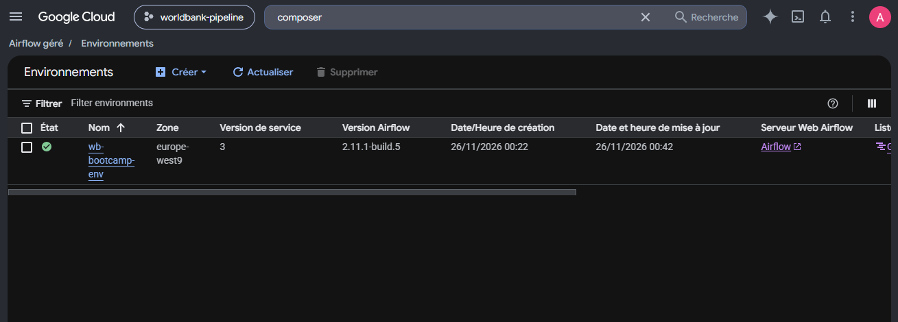
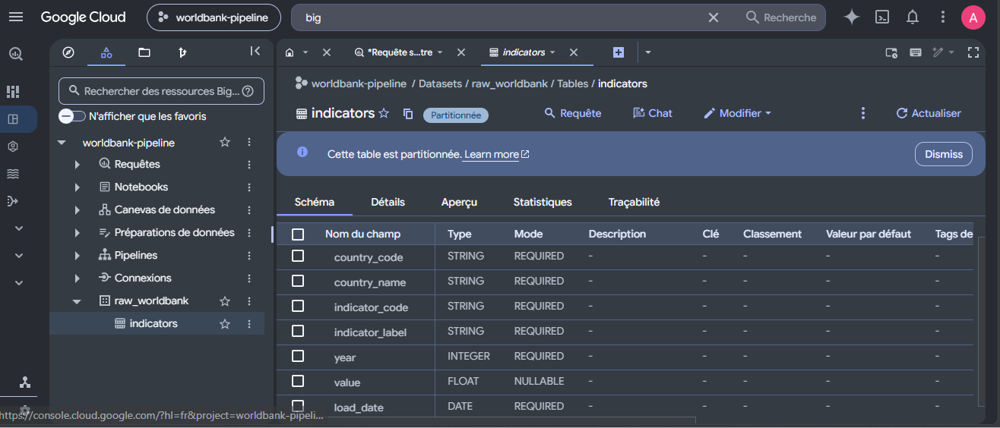
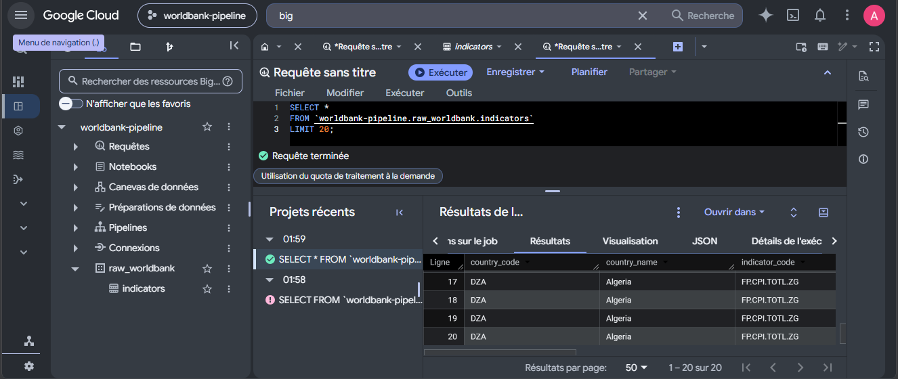

# World Bank Indicators Ingestion Pipeline (Airflow & GCP)

Pipeline ELT orchestré avec **Apache Airflow (Cloud Composer 3)** permettant d'extraire des indicateurs macroéconomiques depuis l'**API World Bank**, de les stocker dans **Google Cloud Storage (GCS)** et de les charger dans **BigQuery** avec contrôle qualité automatisé.

---

## Architecture du pipeline

```text
World Bank API ──▶ [PythonOperator: extract_and_upload] ──▶ Google Cloud Storage (JSONL)
                                                                     │
                                                                     ▼
BigQuery (raw_worldbank.indicators) ◀── [GCSToBigQueryOperator: load_to_bigquery]
        │
        ▼
[BigQueryCheckOperator: check_countries_loaded] (Contrôle qualité)
```

## Détails techniques

- **Environnement Cloud Composer** : `wb-bootcamp-env` (Composer 3, Airflow `2.11.1`, région `europe-west9`)
- **Projet GCP** : `worldbank-pipeline`
- **Table cible BigQuery** : `worldbank-pipeline.raw_worldbank.indicators`
- **Stratégie de chargement** : `WRITE_TRUNCATE`, partitionnement par `load_date`, clustering par `country_code`
- **Pays suivis** : Maroc (`MAR`), Tunisie (`TUN`), Algérie (`DZA`), Égypte (`EGY`), France (`FRA`)

### Schéma de la table `indicators`

| Champ | Type | Mode |
|---|---|---|
| `country_code` | STRING | REQUIRED |
| `country_name` | STRING | REQUIRED |
| `indicator_code` | STRING | REQUIRED |
| `indicator_label` | STRING | REQUIRED |
| `year` | INTEGER | REQUIRED |
| `value` | FLOAT | NULLABLE |
| `load_date` | DATE | REQUIRED |

## Structure du dépôt

```text
worldbank-pipeline/
├── dags/
│   └── worldbank_gdp_ingestion.py                  # DAG Airflow principal
├── images/
│   ├── 01_bigquery_schema_indicators.png           # Schéma de la table BigQuery
│   ├── 02_bigquery_select_limit20.png              # Résultat de SELECT ... LIMIT 20
│   └── 03_cloud_composer_environment_healthy.png   # Environnement Composer (Healthy)
├── test_extract.py                                 # Test local de l'API World Bank
└── README.md
```


## Captures d'écran

### 1. Environnement Cloud Composer à l'état Healthy



### 2. Schéma de la table BigQuery `raw_worldbank.indicators`



### 3. Requête BigQuery `SELECT * ... LIMIT 20`



